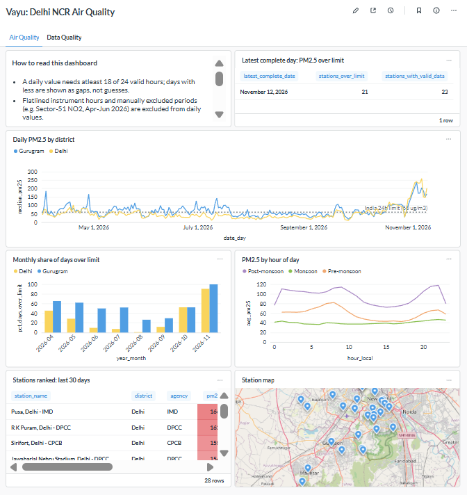
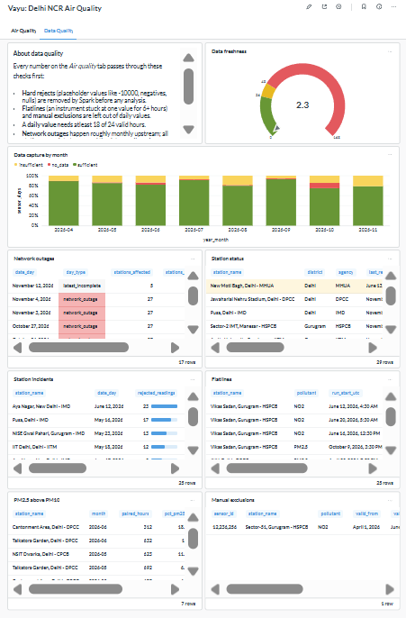
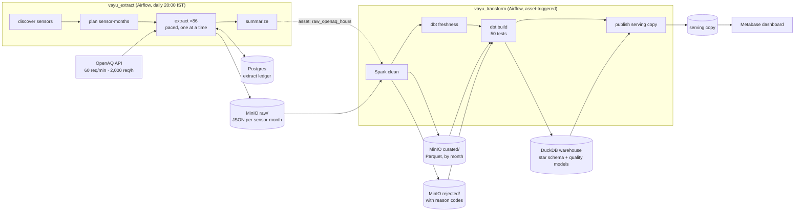

# Vayu — an air-quality lakehouse for Delhi NCR

An end-to-end data pipeline that ingests hourly air-quality readings from the OpenAQ API, cleans
them with Spark, models them into a tested star schema with dbt on DuckDB, and serves a Metabase
dashboard that shows not only the air quality, but **how far each number can be trusted**.

*Vayu* (वायु) is Sanskrit/Hindi for air.



---

## At a glance

| | |
|---|---|
| **Scope** | 29 government monitoring stations within 25 km of Gurugram · 86 sensors · PM2.5, PM10, NO2 |
| **History** | 1 April 2026 onward, hourly, updated daily |
| **Volume** | ~350,000 hourly readings · 594 raw sensor-month files |
| **Tests** | 50 dbt tests on every run, plus count reconciliation at every layer |
| **Findings** | 30 documented findings about the source data, each traced to a rule in code ([data profile](docs/data-profile.md)) |
| **Cost** | ₹0. Everything runs locally in Docker; no cloud services |

---

## Questions it answers

1. How bad is the air right now, and how many stations exceed India's 24-hour PM2.5 limit?
2. How has PM2.5 changed day by day in Delhi and Gurugram?
3. Which months are worst? (The seasonal cycle: high pre-monsoon, cleanest in August, rising sharply from October.)
4. Which stations are worst right now, and where are they?
5. What time of day is pollution worst, by season?
6. **Can these numbers be trusted?** Data capture, network outages, instrument incidents, flatlined sensors, physically inconsistent readings, and every manual exclusion.



---

## Architecture



| Layer | Tool | What it does |
|---|---|---|
| Orchestration | **Airflow 3.3** (LocalExecutor) | Two DAGs linked by an Airflow Asset; retries, pools, failure handling |
| Object storage | **MinIO** (S3-compatible; `pgsty/minio` fork) | Raw, curated and rejected zones |
| State | **Postgres 16** | Extraction ledger; Airflow and Metabase metadata |
| Processing | **Spark 4.1** (PySpark, local mode) | Flatten, type, deduplicate, validate, write partitioned Parquet |
| Query engine | **DuckDB 1.5** | Reads Parquet in MinIO directly; runs dbt |
| Modeling | **dbt Core 1.11** + dbt-duckdb | Star schema, aggregate facts, quality models, tests |
| BI | **Metabase 0.63** + DuckDB driver | Two-tab dashboard |
| Packaging | **Docker Compose** | One `docker compose up` |

---

## How it works

### 1. Ingestion: `vayu_extract`

- **Discovery** finds every sensor in scope on every run (stations appear, fail, and return; see F26).
  Scope excludes known low-cost sensor providers rather than trusting OpenAQ's `isMonitor` flag,
  which silently dropped 25% of government stations (F16).
- **Planning** compares what should exist (each sensor's months) with what the **ledger** says is
  done. A month is final only once fetched after month-end + a 7-day lookback, so late-arriving data
  is captured. The pipeline is **state-based, not schedule-based**: missed runs, crashes and weeks of
  downtime all heal with one normal run.
- **Extraction** fetches one sensor-month per request (≤ 744 hourly readings, one API page), writes
  the untouched response to MinIO in a provenance envelope, then records the ledger row: **data first,
  then the record**, committed per month. A crash can repeat at most one request, never lose data.
- **Rate limiting**: one request every 2 s (under both limits indefinitely), an Airflow pool with one
  slot (parallel tasks can't beat a shared rate limit), header-based pausing, exponential backoff.
- **Failure classes**: transient (retry), permanent (skip, record), poison (record, don't block
  others), fatal (stop the run: e.g. a bad API key).

### 2. Processing: Spark

Explicit schemas (no inference), `try_` parsing under Spark 4's ANSI mode, deduplication on
(sensor, hour), and **two-tier validation**:

| Tier | Rules | Destination |
|---|---|---|
| **Hard reject** (invalid) | null value · placeholder −10000 · −9999/+10000 inside an hourly average · negative · beyond instrument range | `rejected/` with one reason code |
| **Soft flag** (valid but less reliable) | < 75% of sub-hourly readings · flagged by OpenAQ · instrument at its ceiling | `curated/`, flagged |

Every run reconciles: **readings in = curated + rejected + duplicates**, checked before writing,
and read back after.

### 3. Warehouse: dbt

- **Star schema**: `fact_measurement` (grain: one row per sensor per hour; incremental,
  `delete+insert` per raw file) with `dim_location`, `dim_sensor`, `dim_parameter`, `dim_date`.
- **`fact_sensor_daily`**: one row per sensor per day, *including days without data*. A daily value
  needs ≥ 18 of 24 usable hours; flatlined and manually excluded hours don't count.
- **Quality layer**: network outages, station incidents, flatlines (gaps-and-islands), PM2.5 vs PM10
  consistency.
- **Manual overrides** live in a reviewed seed with a reason per row, never hardcoded in SQL.
- **Build → test → publish**: Metabase reads a serving copy published only after all tests pass,
  so a failed build never reaches the dashboard.

---

## Results and measurements

### Storage (Parquet vs JSON)

| Data | Files | Size |
|---|---|---|
| Raw JSON | 594 | 309.69 MB |
| Curated data written as JSON (same rows and columns) | 1 | 197.33 MB |
| **Curated Parquet (snappy)** | 7 | **4.68 MB** |

**Format effect alone: 42× smaller.** Raw JSON → curated Parquet: 66× (format + dropped columns).

### Partition pruning

`WHERE month = 9` scans **1 of 7** files; filtering the same rows by a non-partition column scans
all 7. At ~5 MB the time difference is within noise (13 vs 14 ms): Parquet's row-group statistics
let the non-partition query skip other months after reading only file footers. Partitioning pays
off at volume.

### Raw vs curated: "average PM2.5 in May 2026"

| Source | Time | Average | Min | Max |
|---|---|---|---|---|
| Raw JSON | 143 ms | **52.13** | −10000 | 7430 |
| **Curated Parquet** | **14 ms** | **54.49** | 0.0 | 845 |

Raw data gives a **wrong answer**: sentinel placeholders pull May's average down by 2.36 µg/m³ (~4%).
The 9 removed readings are exactly May's PM2.5 rejects.

### Cleaning

331,321 readings → **331,130 curated**, **191 rejected (0.06%)**, 0 duplicates. OpenAQ's own quality
flags caught all 150 null values but **none of the 31 sentinel problems**: relying on source flags
alone would have passed 38 invalid readings.

### Ingestion and resilience

- First load: 572 requests in ~25 minutes, matching the cost model (2 s pacing + Airflow overhead).
- **Resume test** (5 Oct 2026): deleted the ledger rows for August–September (162 sensor-months:
  81 sensors × 2). Run 1 planned 243 sensor-months (162 never fetched + 81 open for October) and was
  interrupted after **38 sensors**, having saved 76 of the 162. Run 2 planned only the **86 remaining**
  (the other 43 sensors), resuming at exactly the sensor where run 1 stopped (12235083, in sorted
  order). A later run confirmed **0 never fetched** (final: 492 = 330 + 162): nothing duplicated,
  nothing lost.
- **Warehouse rebuilt from scratch** in one run after the `warehouse/` folder was accidentally
  deleted: the raw zone is the source of truth; everything after it is derived.

---

## What the data revealed

A few of the 30 findings in [`docs/data-profile.md`](docs/data-profile.md):

- **F16: a filter that silently dropped 25% of the network.** OpenAQ's `isMonitor` flag was false
  for 7 of 28 government stations. No error, no failed test: found only by checking what the filter
  removed.
- **F19: sentinels hide inside averages.** Besides −10000 placeholders, −9999 and +10000 codes inside
  15-minute readings produced impossible hourly values (−7500, 7430). The first hypothesis about the
  rule would have caught none of them; checking the sub-hourly minimum and maximum first revealed it.
- **F28: the upstream feed fails about monthly.** Five network-wide outages in 6.5 months, every one
  affecting 100% of stations. The lookback window was widened from 3 to 7 days, and a freshness
  warning caught a live outage on its first run.
- **F29/F30: instruments lie quietly.** NO2 at exactly 0.0 for 62 hours; two instruments freezing
  in the same minute (a data logger); and one analyzer cycling through fixed values near 5 ppb for
  11 weeks, found only by comparing it with its peers.
- **F27: a comparison the dashboard refuses to make.** Gurugram's PM2.5 is high relative to PM10,
  mainly in humid months: either a real source difference or a humidity effect on instruments. The
  dashboard compares stations rather than presenting an uncertain city-level difference as fact.

---

## Running it

### Prerequisites

- Docker (Windows: Docker Desktop with WSL2; run everything in the Ubuntu terminal, and keep the
  project inside the Linux filesystem, not under `/mnt/c`).
- 8 GB RAM minimum, 16 GB comfortable. About 20 GB free disk.
- A free OpenAQ API key: [explore.openaq.org/register](https://explore.openaq.org/register).

### Setup

```bash
git clone git@github.com:rahulgrover-rg/vayu-openaq-pipeline.git
cd vayu-openaq-pipeline

# 1. Secrets
cp .env.example .env
#    Fill in passwords and your OpenAQ key, then generate Airflow's keys:
docker run --rm apache/airflow:3.3.1-python3.12 python -c \
  "from cryptography.fernet import Fernet; print(Fernet.generate_key().decode())"   # AIRFLOW_FERNET_KEY
openssl rand -hex 32                                                                 # AIRFLOW_JWT_SECRET
id -u                                                                                # AIRFLOW_UID

# 2. Create every mounted folder BEFORE the first start
#    (Docker creates missing mount folders as root, which Airflow's tasks cannot write to)
mkdir -p logs plugins .cache/ivy warehouse/serving

# 3. Build and start
docker compose build
docker compose up -d

# 4. One-time setup: MinIO buckets and the Airflow pool
docker compose exec minio sh -c 'mc alias set local http://localhost:9000 "$MINIO_ROOT_USER" "$MINIO_ROOT_PASSWORD" && mc mb --ignore-existing local/raw local/curated local/rejected'
docker compose exec airflow-scheduler airflow pools set openaq_api 1 "OpenAQ API: one request stream at a time"
```

| Service | URL |
|---|---|
| Airflow | http://localhost:8080 |
| MinIO console | http://localhost:9001 |
| Metabase | http://localhost:3000 |
| Spark UI (while a job runs) | http://localhost:4040 |

### First run

1. In Airflow, switch on `vayu_extract` and `vayu_transform`, then trigger `vayu_extract`.
   The first load takes ~25 minutes; `vayu_transform` starts automatically afterwards.
2. In Metabase, add a **DuckDB** database: file `/data/vayu_serving.duckdb`, read-only connection.
3. Rebuild the dashboard from [`dashboard/queries.sql`](dashboard/queries.sql).

### Day to day

- `docker compose up -d` to start, `docker compose stop` to stop. Never `down -v` (it deletes the
  MinIO and Postgres volumes).
- The pipeline runs daily at 20:00 IST when the machine is on, and catches up automatically after
  downtime.
- **After a validation rule changes in Spark**, run `dbt build --full-refresh` once (the incremental
  fact table can't detect reclassified old readings; a count test flags the drift).
- **After `vayu_transform` publishes,** restart Metabase (`docker compose restart metabase`) to see
  new data: an open DuckDB connection keeps reading the previous serving copy.

### Running the demo (do this the day before)

1. Start Docker Desktop, then `docker compose up -d --force-recreate` (after a reboot, containers can
   start before WSL's files are mounted).
2. Trigger `smoke_test`: confirms Airflow, Postgres and MinIO in 30 seconds.
3. Trigger `vayu_extract` and let it catch up.
4. Restart Metabase and check both dashboard tabs.

### Troubleshooting

| Symptom | Cause and fix |
|---|---|
| `No module named vayu`, or a mounted folder is empty | Containers started before WSL's files were ready: `docker compose up -d --force-recreate` |
| `Permission denied` writing under `warehouse/` or `logs/` | The folder was created by Docker as root: `sudo chown -R $USER:$USER <folder>` |
| Extract tasks stay queued | The `openaq_api` pool is missing (it lives in Airflow's database): recreate it |
| Dashboard shows old data | Restart Metabase after publishing |
| `warehouse/` deleted or corrupted | Trigger `vayu_transform`: it rebuilds completely from the curated layer |

---

## Design decisions

The reasoning behind each choice, with alternatives considered, is in [`DECISIONS.md`](DECISIONS.md).
The most consequential:

1. **Ledger over a single watermark:** each sensor-month recorded separately, including failure type
   and attempts; a watermark can always be derived from it.
2. **State-based planning:** every run compares desired state with the ledger, so recovery needs no
   special code.
3. **One task per sensor, checkpoints per month:** task granularity and checkpoint granularity are
   separate choices (≈ half the runtime of one task per sensor-month).
4. **Two-tier data quality:** "rejected" means *wrong*; "flagged" means *less reliable*. Downstream
   models decide how to use flagged data.
5. **Prefer rules whose failures are visible** (F16): a denylist of low-cost providers fails loudly;
   the `isMonitor` allowlist failed silently.
6. **Validate before publishing**, at every layer: Spark reconciles before writing; dbt tests before
   the serving copy is replaced.
7. **The raw zone is the source of truth;** every later layer is disposable and rebuildable.
8. **Configuration over hardcoding:** scope, pollutants, pacing and quality thresholds in
   `config/pipeline.yaml` and dbt variables; secrets only in `.env`.

---

## Limitations and scaling

**Single-machine assumptions (honest list):**

- Spark runs in local mode inside the Airflow scheduler container, sharing its memory.
- DuckDB allows one writer per file, handled by a serving copy; Metabase must reconnect to see new data.
- Airflow's scheduler and executor run on one machine (LocalExecutor).
- The incremental fact table relies on `fetched_at`; Spark rule changes require a full refresh.

**Path to cloud.** Each component was chosen to be interface-compatible with a managed equivalent:

| Here | Managed equivalent | What changes |
|---|---|---|
| MinIO | Amazon S3 | Endpoint and IAM credentials |
| PySpark local mode | EMR / Databricks / Spark Connect | Session setup; transformation code unchanged |
| DuckDB + dbt-duckdb | Snowflake / BigQuery / MotherDuck | dbt adapter and profile |
| Airflow in Docker | MWAA / Cloud Composer / Astronomer | Deployment; DAG code unchanged |
| Local files and a serving copy | A warehouse server BI tools query directly | The publish step disappears |

Atomic writes on object storage would come from a table format (Delta Lake or Apache Iceberg)
rather than plain Parquet overwrites.

---

## Future work

- Add relative-humidity sensors to scope to test whether Gurugram's high PM2.5/PM10 ratio follows
  humidity (F27).
- Automated low-variability and step-change detection (F30 was found by hand, through peer comparison).
- A usable-hour flag at hourly grain, so hour-of-day analysis also excludes flatline hours.
- Escalate sensor-months that fail transiently across many runs to permanent (F15).
- Extend scope beyond NCR: discovery is configuration-driven (`scope` in `pipeline.yaml`).

---

## Repository layout

```
├── dags/
│   ├── vayu_extract.py        # ingestion DAG
│   ├── vayu_transform.py      # Spark → dbt → publish DAG
│   ├── smoke_test.py          # infrastructure health check
│   ├── sql/                   # ledger table definition
│   └── vayu/                  # pipeline code (no Airflow imports, except assets.py)
├── dbt/                       # staging, marts, quality models, seeds, tests
├── dashboard/queries.sql      # SQL behind every dashboard card
├── config/pipeline.yaml       # scope, pacing, quality thresholds
├── docs/data-profile.md       # 30 findings about the source data
├── DECISIONS.md               # every design decision, with reasoning
├── Dockerfile                 # Airflow + Java + PySpark + DuckDB + dbt (separate venv)
└── docker-compose.yml
```

---

## Data and acknowledgments

Air-quality data from [OpenAQ](https://openaq.org), originally from India's Central Pollution
Control Board (CPCB), the Delhi Pollution Control Committee (DPCC), the Haryana State Pollution
Control Board (HSPCB), the Indian Institute of Tropical Meteorology (IITM) and the India
Meteorological Department (IMD). See OpenAQ's terms for data use and attribution.

Air-quality standards: India NAAQS (24-hour) and the WHO 2021 Air Quality Guidelines, as recorded
in `dbt/seeds/parameters.csv`. Verify against the official documents before relying on them.